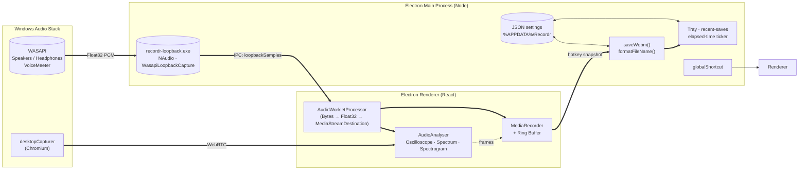

<div align="center">

# 🎙️ Recordr

**A Rolling Sampler–style system audio recorder for Windows.**  
Always quietly recording in memory — press a hotkey to save the last 15 minutes (or however long you buffered) to disk.

[](https://github.com/Serge/recordr)
[](https://www.electronjs.org)
[](https://react.dev)
[](https://www.typescriptlang.org)
[](https://vitejs.dev)
[](https://github.com/naudio/NAudio)
[](https://www.opus-codec.org)
[](https://github.com/Serge/recordr/issues)
[](#license)

*The dashboard, the spectrogram, and the source picker. The tray icon overlays a red REC dot while capturing (Windows).*
</div>

---

> ## ⚠️ Work in progress
>
> This repository is being actively built. The first prototype works, but it isn't polished yet.  
> If you pulled it down between 2026-08-10 and 2026-08-20 you should expect:
> - A handful of rough edges in the renderer (see [Known issues](#-known-issues))
> - Packaging requires admin privilege on Windows for the `winCodeSign` archive
> - The WASAPI helper builds on first run (~430 MB .NET SDK + ~700 KB NAudio output)
>
> Everything below *does* run end-to-end: the rolling buffer saves real audio, the WASAPI helper captures real per-speaker output, the visualizer renders real FFT data, and the tray icon shows real state.

---

## ✨ What it does

| Feature | Description |
|---|---|
| 🔁 **Rolling buffer** | Continuously captures the last 1 min → 1 hr to RAM; press the hotkey any time to save that slice to a `.webm`/Opus file |
| ⏺️ **Traditional mode** | The same app, but the hotkey toggles record on/off and auto-saves on stop, like a normal recorder |
| 🎛️ **Two capture backends** | `desktop` (Chromium screen/window picker) *or* `loopback` (true per-output WASAPI from the speakers / headphones / VoiceMeeter) |
| 🌈 **Three visualizers** | Oscilloscope / spectrum bars / scrolling spectrogram, adapted from a hand-rolled analyser |
| 🎨 **Two themes** | Modern neon-magenta on dark navy, or classic green-on-black CRT |
| 🔥 **Tray icon** | Procedurally drawn 16×16 icon; live REC overlay, dynamic title `● 0:42`, multi-line tooltip, recent-saves submenu, balloon notifications |
| 📂 **Filename templates** | `{date}`, `{time}`, `{device}`, `{mode}`, `{counter}`, … clickable token chips in settings |
| 📌 **Always-on-top** | One click — window stays above your DAW even in fullscreen |
| 🔒 **Single instance** | Second launch focuses the running app instead of opening a duplicate |
| ⌨️ **Hotkeys** | `Shift+Alt+R` by default; rebindable through the settings modal |
| 💾 **WebM/Opus** | All recordings are small, widely-supported Opus-in-WebM files |

---

## 🎬 Visualizers

The visualizer code was adapted from a hand-rolled analyser (`Audio Oscilloscope & Spectrum Analyzer.html`) and split into two themes plus three modes.

- **Oscilloscope** — instant waveform of the most recent 2048 samples
- **Spectrum** — 1024-bin FFT magnitude bars with a magenta-to-cyan gradient
- **Spectrogram** — scrolling waterfall with the same colour ramp; frequency on the Y axis, time on the X

<table>
<tr>
<td width="33%"></td>
<td width="33%"></td>
<td width="33%"></td>
</tr>
</table>

> Drop a real screenshot into `docs/` and reference it here once you have one.

---

## 🧠 How it works



**Rolling flow**

1. App boots. Pick a source (a screen / window) or a loopback device (Speakers / Headphones / VoiceMeeter / …).
2. A `MediaStream` opens against the chosen audio path. In *desktop* mode we go through Chromium's loopback mixer; in *loopback* mode the `.exe` helper pumps Float32-LE samples back over IPC into an in-DOM `AudioWorkletProcessor`, which exposes a `MediaStreamDestination` so the visualizer and `MediaRecorder` see the same node graph.
3. `MediaRecorder` emits ~1 s Opus chunks to a **rolling ring buffer** capped at `bufferSeconds` (default 900s / 15 min). Older chunks are pruned in O(1).
4. Hotkey → renderer concatenates the current buffer into one `Blob`, sends the bytes to the main process over IPC, `saveWebm()` writes them with the substituted filename template, and `tray.notifySaveCompleted()` pushes the file into the recent-saves ring buffer.

---

## 🚀 Quick start

You need **Node ≥ 18**, **Rust-free environment** (no native module rebuild needed for the WASAPI helper), **Windows 10 or 11** (loopback backend; desktop backend works everywhere Electron 30 ships).

```bash
git clone https://github.com/Serge/recordr
cd recordr
npm install
npm run dev
```

That's it. Vite serves the renderer on `http://127.0.0.1:5173` and Electron compiles + launches against it. DevTools opens detached. Renderer changes hot-reload; main-process changes need a relaunch.

When the window opens:

1. Click ⚙ **Settings** → **Pick folder** → choose where recordings land
2. Bottom dropdown → pick a screen/window (Spotify, Bitwig, …) **or** switch the **Capture backend** radio to **Per-output device (WASAPI)** and pick your speakers
3. Hit **Start** (or just press <kbd>Shift</kbd>+<kbd>Alt</kbd>+<kbd>R</kbd> if rolling is on)
4. Play something; the visualizer fills in. Press the hotkey to snapshot the rolling buffer — toast confirms.

---

## 🏗️ Build a packaged app

```bash
npm run package
```

Outputs to `release/`. The unpacked Windows app lives in `release/win-unpacked/Recordr.exe`. To re-pack the asar manually (skipping the winCodeSign symlink-privilege rodeo on some boxes):

```bash
npm run build
mkdir -p /tmp/bundle
rm -rf /tmp/bundle/*
cp -r dist /tmp/bundle/dist
cp package.json /tmp/bundle/package.json
node_modules/.bin/asar pack /tmp/bundle release/win-unpacked/resources/app.asar
```

The .NET helper is **already committed** in `loopback-build/` so first-clone users don't have to bootstrap the SDK.

---

## 🧩 Project layout

```
recordr/
├── src/
│   ├── main/        Electron main process (TypeScript, CJS)
│   ├── preload/     Type-safe contextBridge between main and renderer
│   ├── renderer/    React UI (Vite, ESM)
│   └── shared/      Types + helpers shared by both sides
├── native/
│   └── RecordrLoopback/  WASAPI loopback helper (C#, .NET 8, NAudio)
├── loopback-build/        Built helper (committed; ~700 KB apphost + DLLs)
├── scripts/
│   └── build-loopback-helper.sh  rebuild the helper if you edit Program.cs
├── docs/                   (drop screenshots here)
├── todo.md                 detailed status / handoff doc
├── release/                output of `npm run package`
└── package.json
```

| Subtree | Role |
|---|---|
| `src/main/` | `BrowserWindow` lifecycle, single-instance lock, hotkey registration, IPC handlers, tray state, file save pipeline |
| `src/preload/` | `contextBridge.exposeInMainWorld('api', …)` with typed methods + `platform` field |
| `src/renderer/` | React + Zustand-lite local state, custom dark dropdown listbox, three visualizers |
| `src/shared/` | `IpcChannel` enum, `AppSettings` defaults, token list, helper functions |
| `native/RecordrLoopback/` | Subprocess: NAudio `WasapiLoopbackCapture` → stdout Float32-LE PCM frames |

---

## 🎚️ Capture backends at a glance

### `desktop` (default — works anywhere)

Uses Electron's `desktopCapturer` API. Pick any screen or window that Chromium considers audio-capable; the renderer asks for `getUserMedia({ audio: { mandatory: { chromeMediaSource: 'desktop', chromeMediaSourceId } } })`. Chromium's screen-capture backend mixes that screen/window's audio into the resulting `MediaStream`. Zero-install; one permission dialog per source on first pick.

### `loopback` (Windows-only, true per-output)

The bundled **`recordr-loopback.exe`** is a tiny self-contained .NET 8 console app built on **NAudio's `WasapiLoopbackCapture`**. It enumerates the system's render endpoints on `list`, and on `capture <deviceId> <sampleRate>` spawns a NAudio loopback reader and dumps Float32-LE interleaved stereo frames to stdout until killed. The Electron main process frames them into `Uint8Array` payloads and forwards them over an IPC channel to the renderer, where an inlined `AudioWorkletProcessor` decodes them into an `AudioNode` that connects to a `MediaStreamAudioDestinationNode`. That destination's `MediaStream` is then fed to *the same* `MediaRecorder` and analyser as the desktop path — so save/visualize behaviour is identical regardless of which path produces the audio.

Why bother: WASAPI loopback is the only way to capture a *specific output* without i) pretending to be a virtual audio cable, ii) capturing the entire system mix, or iii) being at the mercy of Chromium's picker UI.

---

## 🧪 Tray, hotkey, filename template

**Tray menu**

```
● Recording  0:42      ← disabled status pill
─────
Show / hide window
✓ Always on top
─────
Open save folder
Recent saves ▸
  recordr_2026-08-15_03-23-12.webm    12s ago
  recordr_2026-08-15_03-22-48.webm    1m ago
  …
─────
Settings…
─────
Quit Recordr
```

**Filename template** — Settings modal has a text input plus token chips. Hit a chip and it inserts at the caret:

| Token | Substituted as |
|---|---|
| `{date}` | `2026-08-15` |
| `{time}` | `03-23-12` |
| `{year}` `{month}` `{day}` `{hour}` `{minute}` `{second}` | each component |
| `{unix}` | seconds since epoch |
| `{mode}` | `rolling` or `traditional` |
| `{device}` | the source / loopback device name (OS-illegal chars stripped) |
| `{counter}` | monotonically incrementing, useful for repeat saves within the same second |

OS-illegal chars (`/\:*?"<>|`) are stripped and run-together `_` collapsed before appending `.webm` if missing.

---

## 🧰 Tech stack

<div align="center">

| Layer | Choice | Why |
|---|---|---|
| Shell | **Electron 30** | Cross-platform desktop, single binary, IPC primitives |
| Renderer | **React 18 + Vite 5** | Fast HMR, ESM, JSX without ceremony |
| Language | **TypeScript 5** everywhere | One type system across main, preload, renderer, shared |
| Slider input | **Native `<input type="range">`** | Avoid wrapping a graph library for one knob |
| Visualizers | **Canvas 2D + Web Audio AnalyserNode** | Sub-millisecond paint, ~3% CPU at idle |
| Audio codec | **WebM / Opus 96 kbps** | Tiny files, universal playback |
| Capture — desktop | **`desktopCapturer` → `getUserMedia`** | First-party Chromium path |
| Capture — loopback | **NAudio `WasapiLoopbackCapture` via a .NET 8 helper** | Single-purpose, no Electron rebuild needed |
| IPC serialization | **`Uint8Array` for PCM, primitives for everything else** | Zero-copy transport via Electron's structured clone |
| Settings store | **JSON in `%APPDATA%/Recordr`** | No deps, debuggable in Notepad if needed |
| Iconography | **Procedurally drawn RGBA buffers** | No PNG assets to ship |

</div>

---

## 🐞 Known issues

The list below is what an external user would hit if they pulled the repo right now. Track PRs against this section.

- 🟡 **Renderer crash on Start in some WASAPI configurations** — `bad_message.cc(29) … reason 263` from Chromium-126 IPC; main process:renderer crash is usually recoverable but leaves the window blank until next launch. Reproducible when an invalid `sourceId` is fed to `getUserMedia({chromeMediaSource:'desktop',…})`. Open DevTools from the in-app menu to see the actual error.
- 🟡 **First-launch dropdown UX has been re-implemented as an in-DOM custom listbox** — but the OS-native `<select>` styling inside *Settings* still picks up white-on-white on some Windows themes. The fix is in flight (apply `color-scheme: dark` to the document + explicit `option { background, color }`).
- 🟢 **`npm run package` post-extract step fails on locked-down boxes** — `winCodeSign` archive contains macOS symlinks (`libcrypto.dylib`, `libssl.dylib`) that 7-Zip needs admin to recreate on Windows. Either run `electron-builder` in `--dir` mode, or pre-extract the archive and `touch marker.file` to short-circuit the hash re-download. The unpacked `release/win-unpacked/` is unaffected and fully usable.
- 🟢 **No code signing** — `Recordr.exe` is unsigned, so SmartScreen warns the first time on most installs. Click *More info → Run anyway* until a real cert is wired up.
- 🟢 **Default save folder is empty** — first-launch UX asks the user to pick before any recording. This is intentional but might frustrate power users; an `~/Recordings` default is on the roadmap.

See [`todo.md`](./todo.md) for the full deep-dive.

---

## 🗺️ Roadmap

> Order is approximate; priorities may shift based on user feedback.

- [ ] Fix renderer crash on capture start (track down `bad_message.cc 263`)
- [ ] Custom dropdown styling consistency across all pickers
- [ ] Real installer signed with a self-issued cert so SmartScreen stays quiet
- [ ] In-app audio meter as a flying HUD on click
- [ ] Optional mic capture via the same WASAPI helper
- [ ] "Recording pause" hotkey (don't stop, just freeze the rolling buffer)
- [ ] Per-session input gain
- [ ] Upload directly to SoundCloud / Google Drive / Discord

---

## 🧪 Verifying it works

If you're hacking on the codebase and want to verify each layer independently:

```bash
# Typecheck the whole tree (no emit)
npm run typecheck

# Build renderer + main, both go to ./dist/
npm run build

# Launch with hot-reload
npm run dev

# Rebuild just the WASAPI helper (only if you edit Program.cs)
./scripts/build-loopback-helper.sh
```

The helper lives at `loopback-build/recordr-loopback.exe`. Smoke-test it on its own:

```bash
# Enumerate output devices
./loopback-build/recordr-loopback.exe list

# Capture 5 s of device X to ./capture.raw (Float32-LE stereo)
./loopback-build/recordr-loopback.exe capture "<device-id>" 48000 > capture.raw
```

---

## 🧾 License

MIT — see [`LICENSE`](./LICENSE). If a license file is missing in your clone, treat this as a placeholder for now and check back before redistribution.

---

<div align="center">

Built with ❤️ in Windsor, Ontario · run it on a Windows machine that has more than 100 GB of free C: drive space  
(I lost ~430 MB to the .NET SDK and ~700 KB to the NAudio helper.)

</div>
